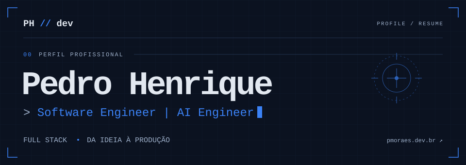
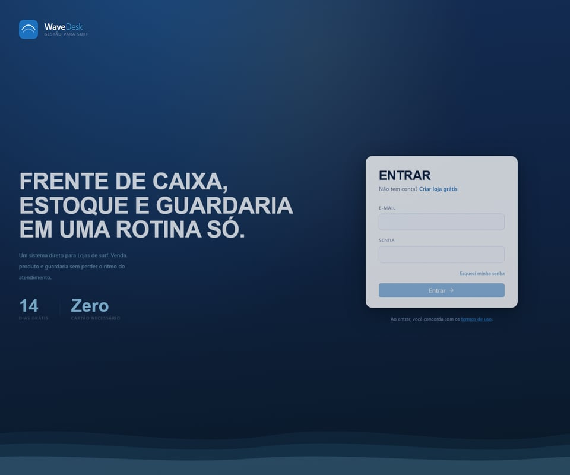
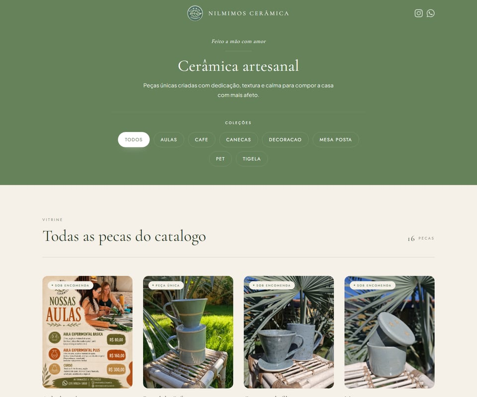
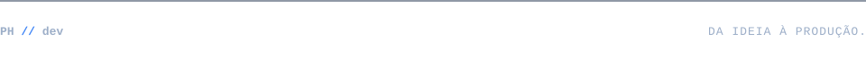

<a href="https://www.pmoraes.dev.br/curriculo">
  <picture>
    <source media="(prefers-color-scheme: dark)" srcset="./assets/profile-dark.svg">
    <source media="(prefers-color-scheme: light)" srcset="./assets/profile-light.svg">
    
  </picture>
</a>

  <a href="https://www.pmoraes.dev.br">Portfólio ↗</a> &nbsp;·&nbsp;
  <a href="https://www.pmoraes.dev.br/curriculo">Currículo ↗</a> &nbsp;·&nbsp;
  <a href="https://www.linkedin.com/in/pedrodev2005/">LinkedIn ↗</a> &nbsp;·&nbsp;
  <a href="mailto:pedro.dev2005@gmail.com">Email ↗</a>

 

## `01` Sobre

Sou **Pedro Henrique**, desenvolvedor Full Stack e **Software Engineer | AI Engineer na Haytek**. Construo aplicações web completas, de interfaces e APIs a integrações e entrega em produção.

Hoje trabalho com **IA agêntica**: agentes LLM, orquestração, RAG e MCP, conectando inteligência artificial a dados, ferramentas e processos corporativos. Também desenvolvo produtos próprios e projetos para clientes, com atenção à qualidade do código e à experiência de quem usa.

## `02` Experiência

### Haytek

**Software Engineer | AI Engineer** · `set/2026 → atual`  
CLT · Híbrido

Desenvolvimento de uma plataforma de IA agêntica com agentes LLM, orquestração, RAG e MCP/plugins. Atuação em APIs, autenticação, permissões, aprovações humanas e integrações corporativas.

`LLM` `RAG` `MCP` `Orquestração de agentes` `APIs REST`

<strong>Anteriormente: Desenvolvedor Full Stack na Haytek</strong> · ago/2025 → ago/2026

Estágio híbrido com rotação pelas áreas de Administração, Dados e Infraestrutura.

- **Administração:** ERP Protheus, ADVPL e SQL, com foco em processos e regras de negócio.
- **Dados:** SQL, Python, dbt e engenharia de dados.
- **Infraestrutura:** Python, GCP, Terraform, Kubernetes, Kong, Elasticsearch e APM. Desenvolvimento de uma aplicação interna integrada ao e-commerce para agilizar pedidos e testes de integração.

`Node.js` `NestJS` `React` `TypeScript` `Docker` `SQL`

### Nilmimos Cerâmica

**Desenvolvedor Full Stack Freelancer** · `2026 · 3 meses`  
Cliente pago · Projeto entregue

Do primeiro contato à entrega, construção de um catálogo digital para peças artesanais, com navegação por coleções e painel administrativo para gestão de produtos.

`Next.js` `TypeScript` `Tailwind CSS` `Supabase` `Vercel`

### WaveDesk

**Criador e Desenvolvedor Full Stack** · `em desenvolvimento`  
SaaS · Produto próprio

SaaS de gestão para lojas de surf: PDV, estoque, clientes e guardaria de pranchas, com acompanhamento de vencimentos e automações de cobrança.

`React` `TypeScript` `Supabase` `Vite`

## `03` Stack

| Área | Tecnologias e ferramentas |
| :--- | :--- |
| **Frontend** | React · Next.js · TypeScript · Tailwind CSS · Vite |
| **Backend** | Node.js · NestJS · Express · APIs REST · Prisma |
| **IA e dados** | LLM · RAG · MCP · Python · SQL · PostgreSQL · Redis · dbt |
| **Infraestrutura** | Docker · Kubernetes · GCP · Terraform · GitHub Actions · CI/CD |

## `04` Projetos em destaque

### [WaveDesk ↗](https://www.wavedesk.com.br/)

**Operação de surf shop em um só lugar.** PDV, estoque, clientes e guardaria, com cobranças recorrentes e avisos automáticos via WhatsApp.

`React` `TypeScript` `Supabase` `Vite`  
[Visitar projeto ↗](https://www.wavedesk.com.br/)

### [Nilmimos Cerâmica ↗](https://nilmimosceramica.com.br/)

**Uma vitrine para peças feitas à mão.** Catálogo digital com navegação por coleções e painel administrativo para gerenciar produtos.

`Next.js` `TypeScript` `Tailwind CSS` `Supabase` `Vercel`  
[Visitar projeto ↗](https://nilmimosceramica.com.br/)

## `05` Formação

**Engenharia de Software** · Bacharelado  
Estácio · `ago/2026 → dez/2028` · Em andamento

**Análise e Desenvolvimento de Sistemas** · Tecnólogo  
Estácio · `ago/2023 → jun/2026` · Concluído

## `06` Vamos construir algo juntos?

Aberto a conversar sobre projetos, produtos digitais e oportunidades.

**[pedro.dev2005@gmail.com](mailto:pedro.dev2005@gmail.com)** · [LinkedIn](https://www.linkedin.com/in/pedrodev2005/) · [Currículo completo](https://www.pmoraes.dev.br/curriculo)

 

<picture>
  <source media="(prefers-color-scheme: dark)" srcset="./assets/footer-dark.svg">
  <source media="(prefers-color-scheme: light)" srcset="./assets/footer-light.svg">
  
</picture>
