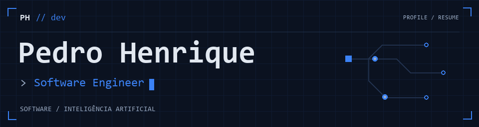

<a href="https://www.pmoraes.dev.br/curriculo">
  <picture>
    <source media="(prefers-reduced-motion: reduce) and (prefers-color-scheme: dark)" srcset="./assets/resume-dark.png">
    <source media="(prefers-reduced-motion: reduce) and (prefers-color-scheme: light)" srcset="./assets/resume-light.png">
    <source media="(prefers-color-scheme: dark)" srcset="./assets/resume-dark.gif">
    <source media="(prefers-color-scheme: light)" srcset="./assets/resume-light.gif">
    
  </picture>
</a>

[Currículo ↗](https://www.pmoraes.dev.br/curriculo) &nbsp;·&nbsp; [LinkedIn ↗](https://www.linkedin.com/in/pedrodev2005/) &nbsp;·&nbsp; [Email ↗](mailto:pedro.dev2005@gmail.com)

Desenvolvimento web de ponta a ponta e **IA agêntica**: interfaces, APIs, agentes LLM e integrações corporativas.

### `01 /` Stack

| | Tecnologias |
| :--- | :--- |
| **Frontend** | `React` `Next.js` `TypeScript` `Tailwind CSS` |
| **Backend** | `Node.js` `NestJS` `Python` `APIs REST` |
| **IA & dados** | `LLM` `RAG` `MCP` `PostgreSQL` `Redis` `dbt` |
| **Infra** | `Docker` `Kubernetes` `GCP` `Terraform` `CI/CD` |

### `02 /` Experiência

**Haytek** · Software Engineer | AI Engineer · `set/2026 → atual` 
Agentes LLM, RAG, MCP, orquestração e integrações corporativas.

**Haytek** · Desenvolvedor Full Stack, estágio · `ago/2025 → ago/2026` 
Rotação em Administração, Dados e Infraestrutura.

### `03 /` Formação

**Engenharia de Software** · Estácio · `2026 → 2028` · Em andamento 
**Análise e Desenvolvimento de Sistemas** · Estácio · `2023 → 2026` · Concluído
