<a href="https://www.pmoraes.dev.br/curriculo">
  <picture>
    <source media="(prefers-reduced-motion: reduce) and (prefers-color-scheme: dark)" srcset="./assets/resume-dark.png">
    <source media="(prefers-reduced-motion: reduce) and (prefers-color-scheme: light)" srcset="./assets/resume-light.png">
    <source media="(prefers-color-scheme: dark)" srcset="./assets/resume-dark.gif">
    <source media="(prefers-color-scheme: light)" srcset="./assets/resume-light.gif">
    
  </picture>
</a>

  <a href="https://www.pmoraes.dev.br/curriculo"><picture><source media="(prefers-color-scheme: dark)" srcset="./assets/badges/file-user-dark.png"></picture></a>
  <a href="https://www.linkedin.com/in/pedrodev2005/"><picture><source media="(prefers-color-scheme: dark)" srcset="./assets/badges/linkedin-dark.png"></picture></a>
  <a href="mailto:pedro.dev2005@gmail.com"><picture><source media="(prefers-color-scheme: dark)" srcset="./assets/badges/mail-dark.png"></picture></a>

**Software, dados e inteligência artificial.** Desenvolvimento de ponta a ponta, de interfaces e APIs à orquestração de agentes e integrações corporativas.

##  Stack técnica

<strong>Frontend</strong>

  <a href="https://www.typescriptlang.org/"><picture><source media="(prefers-color-scheme: dark)" srcset="./assets/badges/typescript-dark.png">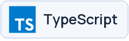</picture></a>
  <a href="https://react.dev/"><picture><source media="(prefers-color-scheme: dark)" srcset="./assets/badges/react-dark.png">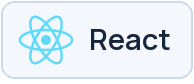</picture></a>
  <a href="https://nextjs.org/"><picture><source media="(prefers-color-scheme: dark)" srcset="./assets/badges/nextjs-dark.png">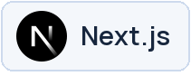</picture></a>
  <a href="https://tailwindcss.com/"><picture><source media="(prefers-color-scheme: dark)" srcset="./assets/badges/tailwindcss-dark.png">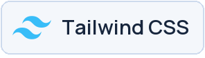</picture></a>

<strong>Backend</strong>

  <a href="https://nodejs.org/"><picture><source media="(prefers-color-scheme: dark)" srcset="./assets/badges/nodejs-dark.png">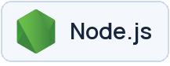</picture></a>
  <a href="https://nestjs.com/"><picture><source media="(prefers-color-scheme: dark)" srcset="./assets/badges/nestjs-dark.png">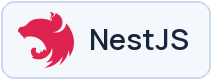</picture></a>
  <a href="https://www.python.org/"><picture><source media="(prefers-color-scheme: dark)" srcset="./assets/badges/python-dark.png">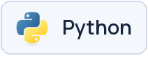</picture></a>
  <a href="https://www.postgresql.org/"><picture><source media="(prefers-color-scheme: dark)" srcset="./assets/badges/postgresql-dark.png">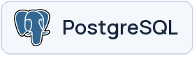</picture></a>

<strong>Inteligência artificial & dados</strong>

  <picture><source media="(prefers-color-scheme: dark)" srcset="./assets/badges/brain-circuit-dark.png">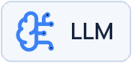</picture>
  <picture><source media="(prefers-color-scheme: dark)" srcset="./assets/badges/database-search-dark.png">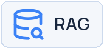</picture>
  <a href="https://modelcontextprotocol.io/"><picture><source media="(prefers-color-scheme: dark)" srcset="./assets/badges/modelcontextprotocol-dark.png"></picture></a>
  <a href="https://redis.io/"><picture><source media="(prefers-color-scheme: dark)" srcset="./assets/badges/redis-dark.png">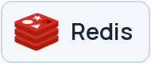</picture></a>
  <a href="https://www.getdbt.com/"><picture><source media="(prefers-color-scheme: dark)" srcset="./assets/badges/dbt-dark.png">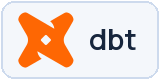</picture></a>

<strong>Cloud & infraestrutura</strong>

  <a href="https://www.docker.com/"><picture><source media="(prefers-color-scheme: dark)" srcset="./assets/badges/docker-dark.png">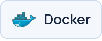</picture></a>
  <a href="https://kubernetes.io/"><picture><source media="(prefers-color-scheme: dark)" srcset="./assets/badges/kubernetes-dark.png"></picture></a>
  <a href="https://cloud.google.com/"><picture><source media="(prefers-color-scheme: dark)" srcset="./assets/badges/googlecloud-dark.png"></picture></a>
  <a href="https://developer.hashicorp.com/terraform"><picture><source media="(prefers-color-scheme: dark)" srcset="./assets/badges/terraform-dark.png">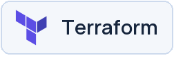</picture></a>
  <a href="https://github.com/features/actions"><picture><source media="(prefers-color-scheme: dark)" srcset="./assets/badges/githubactions-dark.png"></picture></a>

##  Experiência

### Software Engineer | AI Engineer

**Haytek** &nbsp;·&nbsp; set/2026 → atual &nbsp;·&nbsp; Híbrido

Plataforma de IA agêntica: **LLM, RAG, MCP e orquestração**, com APIs, autenticação, permissões e integrações corporativas.

<strong>Desenvolvedor Full Stack · Haytek</strong> &nbsp;·&nbsp; ago/2025 → ago/2026

Estágio com rotação em Administração, Dados e Infraestrutura. Atuação com Protheus/ADVPL, SQL, Python, dbt, GCP, Terraform e Kubernetes.

##  Formação

**Engenharia de Software** 
Estácio &nbsp;·&nbsp; Bacharelado &nbsp;·&nbsp; 2026 → 2028 &nbsp;·&nbsp; Em andamento

**Análise e Desenvolvimento de Sistemas** 
Estácio &nbsp;·&nbsp; Tecnólogo &nbsp;·&nbsp; 2023 → 2026 &nbsp;·&nbsp; Concluído
